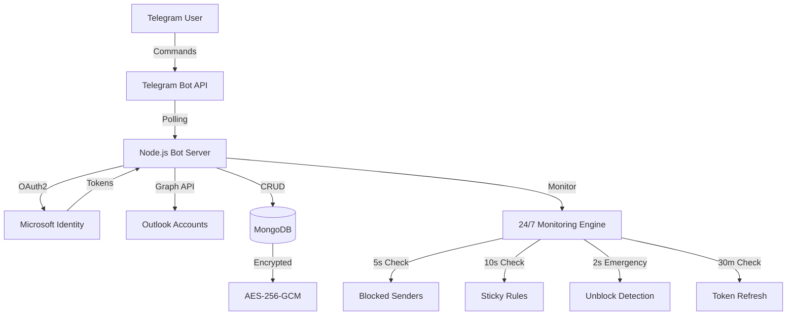

# 📘 **OUTLOOK ACCOUNT CONTROLLER BOT - GITHUB README**


<p align="center">
  <a href="https://github.com/zahidghotia/outlook-telegram/stargazers">
    
  </a>
  <a href="https://github.com/zahidghotia/outlook-telegram/network/members">
    
  </a>
  <a href="https://github.com/zahidghotia/outlook-telegram/issues">
    
  </a>
  <a href="https://github.com/zahidghotia/outlook-telegram/blob/main/LICENSE">
    
  </a>
</p>

<p align="center">
  <a href="#">
    
  </a>
  <a href="#">
    
  </a>
  <a href="#">
    
  </a>
  <a href="#">
    
  </a>
</p>

<p align="center">
  
  
  
  
  
</p>

---

<h1 align="center">⚡ OUTLOOK ACCOUNT CONTROLLER ⚡</h1>
<h3 align="center"><i>Telegram Bot for Ultimate Outlook Email Management • 2-5 Second Response Time</i></h3>

<br>

<p align="center">
  
</p>

<br>

<p align="center">
  <a href="#-features">✨ Features</a> •
  <a href="#-demo">🎥 Demo</a> •
  <a href="#-quick-start">⚡ Quick Start</a> •
  <a href="#-commands">📋 Commands</a> •
  <a href="#-architecture">🏗️ Architecture</a> •
  <a href="#-monitoring">🔍 Monitoring</a> •
  <a href="#-deployment">🚀 Deployment</a> •
  <a href="#-faq">❓ FAQ</a>
</p>

<br>

---

## 🏆 **AWESOME FEATURES**

<table align="center">
  <tr>
    <td width="33%" align="center">
      <br>
      <b>📧 Multi-Account</b><br>
      <sub>Unlimited Outlook accounts from 1 Telegram</sub>
    </td>
    <td width="33%" align="center">
      <br>
      <b>⚡ Ultra-Fast</b><br>
      <sub>2-5 second response time • 10x faster</sub>
    </td>
    <td width="33%" align="center">
      <br>
      <b>🛡️ Auto Block</b><br>
      <sub>Block + Forward spam • Auto-reblock in 2s</sub>
    </td>
  </tr>
  <tr>
    <td width="33%" align="center">
      <br>
      <b>📨 Ghost Forward</b><br>
      <sub>Forward + Delete original • Stealth mode</sub>
    </td>
    <td width="33%" align="center">
      <br>
      <b>🔄 Auto Restore</b><br>
      <sub>Sticky rules auto-recover in 10s</sub>
    </td>
    <td width="33%" align="center">
      <br>
      <b>💾 Auto Backup</b><br>
      <sub>Daily backups • Point-in-time restore</sub>
    </td>
  </tr>
  <tr>
    <td width="33%" align="center">
      <br>
      <b>📊 Smart Reports</b><br>
      <sub>Daily/Weekly/Monthly analytics</sub>
    </td>
    <td width="33%" align="center">
      <br>
      <b>🔐 Military Grade</b><br>
      <sub>AES-256-GCM token encryption</sub>
    </td>
    <td width="33%" align="center">
      <br>
      <b>🤖 30+ Commands</b><br>
      <sub>Complete control via Telegram</sub>
    </td>
  </tr>
</table>

---

## 🎥 **LIVE DEMO**


<p align="center">
  <a href="#">
    
  </a>
  <a href="#">
    
  </a>
</p>

---

## ⚡ **QUICK START**

### 📋 **Prerequisites**

<table>
  <tr>
    <td> Node.js 18.x+</td>
    <td> MongoDB 6.x+</td>
  </tr>
  <tr>
    <td> Azure App Registration</td>
    <td> Telegram Bot Token</td>
  </tr>
</table>

### 🚀 **1-Minute Setup**

```bash
# Clone the repository
git clone https://github.com/zahidghotia/outlook-telegram.git
cd outlook-telegram

# Install dependencies
npm install

# Configure environment
cp .env.example .env
nano .env  # Add your credentials

# Start MongoDB
mongod

# Launch the bot
npm start

# For restricted regions (Iran/Pakistan):
HTTPS_PROXY=http://your-proxy:port node server.js
```

### 🔧 **Environment Configuration**

<details>
<summary><b>📁 Click to see .env configuration</b></summary>

```env
# 🎯 Microsoft Azure
AZURE_CLIENT_ID=your_application_client_id
AZURE_CLIENT_SECRET=your_client_secret
AZURE_TENANT_ID=common

# 🤖 Telegram
TELEGRAM_BOT_TOKEN=your_bot_token_from_botfather
TELEGRAM_PROXY=http://proxy:port  # For restricted regions

# 💾 Database
MONGODB_URI=mongodb://localhost:27017/outlookbot

# 🔐 Encryption (MUST be 32+ characters!)
ENCRYPTION_KEY=your-super-strong-encryption-key-min-32-chars!!

# ⚙️ App Settings
PORT=3000
REDIRECT_URI=http://localhost:3000/auth/callback
FORWARD_TARGET_EMAIL=monitoring@yourdomain.com
```
</details>

---

## 📋 **COMPLETE COMMAND REFERENCE**

<details>
<summary><b>📧 Click to expand ACCOUNT MANAGEMENT commands (7 commands)</b></summary>

| Command | Description | Example |
|---------|-------------|---------|
| `/add` | Connect new Outlook account | `/add` |
| `/list` | Show all your accounts | `/list` |
| `/status [email]` | Detailed account status | `/status user@outlook.com` |
| `/history [email]` | Account activity history | `/history user@outlook.com` |
| `/reconnect [email]` | Fix expired token | `/reconnect user@outlook.com` |
| `/remove [email]` | Remove account (auto-backup!) | `/remove user@outlook.com` |
| `/remove all` | Remove ALL accounts | `/remove all` |

</details>

<details>
<summary><b>🚫 Click to expand SENDER CONTROL commands (8 commands)</b></summary>

| Command | Description | Example |
|---------|-------------|---------|
| `/block [sender]` | Block sender/domain | `/block spam@example.com` |
| `/block @[domain]` | Block entire domain | `/block @ebay.com` |
| `/block all:[sender]` | Block on ALL accounts | `/block all:spam.com` |
| `/block email\|sender` | Block on specific account | `/block user@outlook.com\|spam.com` |
| `/unblock [sender]` | Unblock sender/domain | `/unblock @ebay.com` |
| `/blocked` | Show all blocked senders | `/blocked` |
| `/blocked [email]` | Show blocked for account | `/blocked user@outlook.com` |
| `/check [domain]` | Check domain status | `/check ebay.com` |

</details>

<details>
<summary><b>📨 Click to expand FORWARD commands (4 commands)</b></summary>

| Command | Description | Example |
|---------|-------------|---------|
| `/forward [sender] [email]` | Forward all emails from sender | `/forward @ebay.com friend@gmail.com` |
| `/forward [sender] [email]` | Forward specific sender | `/forward spammer@example.com archive@gmail.com` |
| `/forward off [sender]` | Disable ALL forwarding for sender | `/forward off @ebay.com` |
| `/forward off [sender]\|[target]` | Disable SPECIFIC forward | `/forward off spam@example.com\|archive@gmail.com` |

</details>

<details>
<summary><b>📋 Click to expand RULE MANAGEMENT commands (6 commands)</b></summary>

| Command | Description | Example |
|---------|-------------|---------|
| `/rules [email]` | List all rules | `/rules user@outlook.com` |
| `/rule add` | Create custom rule | `/rule add BlockShopify \| user@outlook.com \| sender:shopify.com \| action:delete` |
| `/rule toggle "name" [email]` | Enable/disable rule | `/rule toggle "BlockShopify" user@outlook.com` |
| `/rule remove "name" [email]` | Delete rule | `/rule remove "BlockShopify" user@outlook.com` |
| `/rule restore "name" [email]` | Restore deleted rule | `/rule restore "BlockShopify" user@outlook.com` |
| `/rule backup [email]` | Backup all rules | `/rule backup user@outlook.com` |

</details>

<details>
<summary><b>💾 Click to expand BACKUP & RESTORE commands (8 commands)</b></summary>

| Command | Description | Example |
|---------|-------------|---------|
| `/backup [email]` | Create full backup | `/backup user@outlook.com` |
| `/backup all` | Backup ALL accounts | `/backup all` |
| `/backups [email]` | List all backups | `/backups user@outlook.com` |
| `/restore [email] [id]` | Restore from backup | `/restore user@outlook.com backup_123456` |
| `/snapshot [email]` | Quick state snapshot | `/snapshot user@outlook.com` |
| `/compare [email] [id]` | Compare with backup | `/compare user@outlook.com backup_123456` |
| `/auto backup [email] [on/off]` | Toggle auto backup | `/auto backup user@outlook.com on` |
| `/delete backup [email] [id]` | Delete backup | `/delete backup user@outlook.com backup_123456` |

</details>

<details>
<summary><b>📊 Click to expand REPORTS & STATS commands (10 commands)</b></summary>

| Command | Description | Example |
|---------|-------------|---------|
| `/report daily` | Today's activity summary | `/report daily` |
| `/report weekly` | Last 7 days analytics | `/report weekly` |
| `/report monthly` | 30-day detailed report | `/report monthly` |
| `/report [email]` | Account-specific report | `/report user@outlook.com` |
| `/summary` | Quick overview | `/summary` |
| `/stats` | Bot performance stats | `/stats` |
| `/logs` | Recent activity (all accounts) | `/logs` |
| `/logs [email]` | Account-specific logs | `/logs user@outlook.com` |
| `/export json` | Export all data as JSON | `/export json` |
| `/export csv` | Export all data as CSV | `/export csv` |

</details>

<br>

<p align="center">
  <b>🔥 TOTAL: 43+ COMMANDS • EVERYTHING AT YOUR FINGERTIPS 🔥</b>
</p>

---

## 🏗️ **SYSTEM ARCHITECTURE**




---

## 🔍 **ULTRA-FAST MONITORING SYSTEM**

<p align="center">
  
  
  
</p>

<table align="center">
  <tr>
    <th>Monitor Type</th>
    <th>Frequency</th>
    <th>Response Time</th>
    <th>Technology</th>
  </tr>
  <tr>
    <td><b>🚫 Blocked Senders</b></td>
    <td>Every 5 seconds</td>
    <td><b>⚡ 2-5 sec</b></td>
    <td><code>setInterval + Cache</code></td>
  </tr>
  <tr>
    <td><b>🛡️ Sticky Rules</b></td>
    <td>Every 10 seconds</td>
    <td><b>⚡ 10 sec</b></td>
    <td><code>setInterval + Validation</code></td>
  </tr>
  <tr>
    <td><b>🚨 Emergency Unblock</b></td>
    <td>Every 2 seconds!</td>
    <td><b>⚡ 2 sec</b></td>
    <td><code>Priority Queue</code></td>
  </tr>
  <tr>
    <td><b>🔐 Token Refresh</b></td>
    <td>Every 30 minutes</td>
    <td><b>🔄 Preemptive</b></td>
    <td><code>Expiry Threshold</code></td>
  </tr>
  <tr>
    <td><b>💾 Auto Backup</b></td>
    <td>Daily 2:00 AM</td>
    <td><b>📅 Scheduled</b></td>
    <td><code>setInterval</code></td>
  </tr>
  <tr>
    <td><b>📊 Daily Report</b></td>
    <td>Daily 9:00 AM</td>
    <td><b>📅 Scheduled</b></td>
    <td><code>setInterval</code></td>
  </tr>
</table>

---

## 💎 **WHY THIS BOT IS UNIQUE**

<table align="center">
  <tr>
    <th>Feature</th>
    <th>Other Bots</th>
    <th>This Bot</th>
    <th>Advantage</th>
  </tr>
  <tr>
    <td><b>⏱️ Unblock Detection</b></td>
    <td>10-30 minutes</td>
    <td><b style="color:#00C853">2-5 SECONDS!</b></td>
    <td>🚀 <b>120x FASTER</b></td>
  </tr>
  <tr>
    <td><b>🔄 Re-block Speed</b></td>
    <td>10-30 minutes</td>
    <td><b style="color:#00C853">2-5 SECONDS!</b></td>
    <td>🚀 <b>120x FASTER</b></td>
  </tr>
  <tr>
    <td><b>🛡️ Sticky Rule Check</b></td>
    <td>1 hour</td>
    <td><b style="color:#FF6D00">10 SECONDS!</b></td>
    <td>🚀 <b>360x FASTER</b></td>
  </tr>
  <tr>
    <td><b>🔐 Token Refresh</b></td>
    <td>Manual / Weekly</td>
    <td><b style="color:#2196F3">AUTO - 30 MIN</b></td>
    <td>✅ Never Expires</td>
  </tr>
  <tr>
    <td><b>📧 Multi-Account</b></td>
    <td>Limited (5-10)</td>
    <td><b style="color:#4CAF50">UNLIMITED</b></td>
    <td>✅ No Limits</td>
  </tr>
  <tr>
    <td><b>💾 Backup System</b></td>
    <td>❌ Not Available</td>
    <td><b style="color:#4CAF50">FULL + AUTO</b></td>
    <td>✅ Point-in-time restore</td>
  </tr>
  <tr>
    <td><b>📊 Reports</b></td>
    <td>❌ Not Available</td>
    <td><b style="color:#4CAF50">DAILY/WEEKLY/MONTHLY</b></td>
    <td>✅ Complete Analytics</td>
  </tr>
</table>

---

## 🚀 **DEPLOYMENT OPTIONS**

<details>
<summary><b>🐳 Docker Deployment (Recommended)</b></summary>

```dockerfile
FROM node:18-alpine
WORKDIR /app
COPY package*.json ./
RUN npm ci --only=production
COPY . .
EXPOSE 3000
CMD ["node", "server.js"]
```

```bash
# Build & Run
docker build -t outlook-bot .
docker run -d --env-file .env -p 3000:3000 --name outlook-bot outlook-bot
```
</details>

<details>
<summary><b>☁️ Heroku Deployment</b></summary>

```bash
# Login to Heroku
heroku login

# Create app
heroku create outlook-controller-bot

# Set environment variables
heroku config:set AZURE_CLIENT_ID=xxx
heroku config:set AZURE_CLIENT_SECRET=xxx
heroku config:set TELEGRAM_BOT_TOKEN=xxx
heroku config:set ENCRYPTION_KEY=xxx

# Deploy
git push heroku main
```
</details>

<details>
<summary><b>🔄 PM2 Production (Self-hosted)</b></summary>

```bash
# Install PM2
npm install -g pm2

# Start bot
pm2 start server.js --name outlook-bot

# Auto-start on reboot
pm2 startup
pm2 save

# Monitor
pm2 monit
pm2 logs outlook-bot
```
</details>

---

## ❓ **FAQ**

<details>
<summary><b>🤔 How many accounts can I manage?</b></summary>
<b>UNLIMITED!</b> The bot has no account limits. Only restriction is 10 accounts per day (anti-abuse).
</details>

<details>
<summary><b>🔒 Are my tokens secure?</b></summary>
<b>YES!</b> We use AES-256-GCM encryption with unique salt, IV, and authentication tags per token. Industry standard!
</details>

<details>
<summary><b>⚡ How is it so fast?</b></summary>
<b>2-5 second response time</b> comes from:
• In-memory state caching
• Parallel API calls with Promise.all
• 2-second emergency priority queue
• MongoDB lean queries
</details>

<details>
<summary><b>💸 Is it free?</b></summary>
<b>YES! 100% FREE and open source.</b> No paid features, no hidden costs.
</details>

<details>
<summary><b>🌍 Can I use it in restricted regions?</b></summary>
<b>YES!</b> Built-in proxy support for Iran, Pakistan, China, etc. Set `TELEGRAM_PROXY` in .env.
</details>

<details>
<summary><b>🔄 What if Microsoft changes API?</b></summary>
<b>We adapt quickly!</b> Active maintenance, community contributions welcome. Open source = future-proof.
</details>

---

## 📊 **PROJECT STATS**

<p align="center">
  
  
  
  
</p>

---

## 🤝 **CONTRIBUTING**

<p align="center">
  <b>Contributions are what make the open source community amazing! 🚀</b>
</p>

<table align="center">
  <tr>
    <td align="center">
      <a href="#">
        <br>
        <b>1. Fork it</b>
      </a>
    </td>
    <td align="center">
      <a href="#">
        <br>
        <b>2. Create branch</b>
      </a>
    </td>
    <td align="center">
      <a href="#">
        <br>
        <b>3. Commit changes</b>
      </a>
    </td>
    <td align="center">
      <a href="#">
        <br>
        <b>4. Push to branch</b>
      </a>
    </td>
    <td align="center">
      <a href="#">
        <br>
        <b>5. Open PR</b>
      </a>
    </td>
  </tr>
</table>

---

## 📄 **LICENSE**

<p align="center">
  
</p>

```
MIT License

Copyright (c) 2026 Zahid Ghotia

Permission is hereby granted, free of charge, to any person obtaining a copy
of this software and associated documentation files...
```

---

## ⭐ **SUPPORT THE PROJECT**

<p align="center">
  <b>If this project helped you, please consider:</b>
</p>

<p align="center">
  <a href="https://github.com/zahidghotia/outlook-telegram-bot">
    
  </a>
  <a href="https://github.com/zahidghotia/outlook-telegram-bot/fork">
    
  </a>
  <a href="https://t.me/zahidghotia">
    
  </a>
</p>

---

<p align="center">
  <b>Made with ❤️ by Zahid Ghotia</b><br>
  
</p>

---

## 📁 **ASSETS FOR BADGES & IMAGES**

**Create these files in your `assets/` folder:**

### 1. **assets/banner.png** - Create with Canva/Photoshop (1200x400)
```
Text: "OUTLOOK ACCOUNT CONTROLLER"
Subtext: "Control Outlook from Telegram • 2-5 Second Response"
Logo: Telegram + Outlook + Lightning Bolt
```

### 2. **assets/logo.png** - Square logo (200x200)
```
Outlook logo + Telegram logo merged with lightning bolt
```

### 3. **assets/demo1.png** - Screenshot of /list command
### 4. **assets/demo2.png** - Screenshot of /block command
### 5. **assets/demo3.png** - Screenshot of /report daily

---

## 🎨 **BANNER GENERATOR TOOLS**

| Tool | Link | Purpose |
|------|------|---------|
| **Canva** | https://www.canva.com | Free banner design |
| **Shields.io** | https://shields.io | Custom badges |
| **Readme Typing SVG** | https://readme-typing-svg.herokuapp.com | Animated text |
| **Mermaid Live** | https://mermaid.live | Architecture diagrams |
| **Img Shields** | https://img.shields.io | Status badges |

---

**


# 📘 **OUTLOOK BOT - QUICK COMMAND GUIDE FOR CLIENTS**

<p align="center">
  
  
</p>

---

# 🎯 **HOW TO USE THIS BOT - SIMPLE STEPS**

## 📌 **BEFORE YOU START**
- You need a **Telegram account**
- You need **Outlook/Hotmail/Live accounts** to control
- That's it! No technical knowledge required ✅

---

# 📧 **1. ACCOUNT COMMANDS**

---

## 🟢 **/add - Add New Outlook Account**

**Step-by-Step:**

| Step | Action | Example |
|------|--------|---------|
| **1** | Type `/add` in Telegram | `/add` |
| **2** | Click the blue login link | [🔐 LOGIN MICROSOFT] |
| **3** | Login with your Outlook email | `your@outlook.com` |
| **4** | Click "Accept" for permissions | ✅ Accept |
| **5** | **Page goes blank** - Copy FULL URL | `http://localhost:3000/auth/callback?code=...` |
| **6** | Paste URL back in Telegram | Press Send |

✅ **Done! Your account is now connected.**

---

## 📋 **/list - View All Your Accounts**

**Command:**
```
/list
```

**What you see:**
```
✅ zahid@outlook.com - Active
🔄 ali@hotmail.com - Reconnect needed
✅ sam@live.com - Active
```

✅ = Working fine  
🔄 = Need reconnect (use /reconnect)

---

## ℹ️ **/status - Check Account Details**

**Command:**
```
/status zahid@outlook.com
```

**What you see:**
- Account status (Active/Expired)
- When it was added
- Total rules & blocked senders
- Last backup time

---

## 🔄 **/reconnect - Fix Expired Account**

**When to use:** When you see 🔄 icon in /list

**Command:**
```
/reconnect zahid@outlook.com
```

**Process:** Same as /add - Click link, login, paste URL

✅ **Account fixed in 30 seconds!**

---

## 🗑️ **/remove - Remove Account**

**Command:**
```
/remove zahid@outlook.com
```

⚠️ **Auto-backup created before removal!**  
You can restore later with `/restore`

**Remove ALL accounts:**
```
/remove all
```

---

# 🚫 **2. BLOCK COMMANDS**

---

## 🔴 **/block - Block Spam Senders**

**Block specific sender:**
```
/block spammer@example.com
```
✅ All emails from this sender will be **FORWARDED + DELETED**

---

**Block entire domain:**
```
/block @ebay.com
```
✅ All emails from ANY ebay.com email will be **FORWARDED + DELETED**

---

**Block on specific account only:**
```
/block zahid@outlook.com|spam.com
```
✅ Only blocks on zahid@outlook.com, other accounts remain

---

**Block on ALL your accounts:**
```
/block all:spam.com
```
✅ Blocks on EVERY account you own

---

## 🟢 **/unblock - Remove Block**

**Unblock sender:**
```
/unblock spammer@example.com
```

**Unblock domain:**
```
/unblock @ebay.com
```

---

## 📋 **/blocked - View Blocked Senders**

**View all blocked:**
```
/blocked
```

**View blocked for specific account:**
```
/blocked zahid@outlook.com
```

---

## 🔍 **/check - Check Domain Status**

**Command:**
```
/check ebay.com
```

**What you see:**
```
📋 Domain Status: ebay.com
📧 Total Accounts: 3
🚫 Blocked: 3 accounts
📨 Forwarded: 3 accounts
```

---

# 📨 **3. FORWARD COMMANDS**

---

## 📤 **/forward - Forward Emails**

**Forward entire domain:**
```
/forward @ebay.com friend@gmail.com
```
✅ All eBay emails → friend@gmail.com + DELETE original

---

**Forward specific sender:**
```
/forward zahid@outlook.com work@gmail.com
```
✅ zahid@outlook.com's emails → work@gmail.com + DELETE original

---

## 🛑 **/forward off - Stop Forwarding**

**Stop ALL forwarding for a sender:**
```
/forward off @ebay.com
```
✅ All eBay forwarding rules removed

---

**Stop SPECIFIC forward only:**
```
/forward off zahid@outlook.com|work@gmail.com
```
✅ Only removes forwarding to work@gmail.com  
✅ Other forwards (if any) still work!

---

# 📋 **4. RULE COMMANDS**

---

## 📜 **/rules - View All Rules**

**Command:**
```
/rules zahid@outlook.com
```

**What you see:**
```
1. ✅ Sticky_eBay_Microsoft_Rule 🔒
   └ Actions: → neg4pos@gmail.com Delete MarkRead Stop

2. ✅ Forward_@ebay.com_to_archive
   └ Actions: → archive@gmail.com MarkRead

3. ✅ Block_Shopify
   └ Actions: Delete
```

🔒 = Sticky rule (cannot be deleted, auto-restores)

---

## ➕ **/rule add - Create Custom Rule**

**Format:**
```
/rule add RuleName | email | condition:value | action:value
```

**Examples:**

| Purpose | Command |
|---------|---------|
| **Block Shopify emails** | `/rule add BlockShopify | zahid@outlook.com | sender:shopify.com | action:delete` |
| **Forward Amazon orders** | `/rule add AmazonForward | zahid@outlook.com | subject:amazon | forward:archive@gmail.com` |
| **Delete + Forward** | `/rule add GhostMode | zahid@outlook.com | sender:newsletter.com | forward:archive@gmail.com | action:delete` |

**Available Conditions:**
- `subject:keyword` - Email subject contains keyword
- `sender:email/domain` - From specific sender/domain
- `body:keyword` - Email body contains keyword

**Available Actions:**
- `forward:email` - Forward to email address
- `action:delete` - Delete email
- `action:markread` - Mark as read
- `action:stop` - Stop processing more rules

---

## 🔄 **/rule toggle - Enable/Disable Rule**

**Command:**
```
/rule toggle "BlockShopify" zahid@outlook.com
```
✅ Rule ON → OFF or OFF → ON

---

## 🗑️ **/rule remove - Delete Rule**

**Command:**
```
/rule remove "BlockShopify" zahid@outlook.com
```

⚠️ **Cannot remove sticky rules** (ones with 🔒 icon)

---

## ♻️ **/rule restore - Restore Deleted Rule**

**Command:**
```
/rule restore "BlockShopify" zahid@outlook.com
```
✅ Rule restored from database backup

---

## 💾 **/rule backup - Backup All Rules**

**Command:**
```
/rule backup zahid@outlook.com
```
✅ Saves all current rules to database

---

# 💾 **5. BACKUP & RESTORE COMMANDS**

---

## 📀 **/backup - Create Full Backup**

**Backup one account:**
```
/backup zahid@outlook.com
```

**Backup ALL accounts:**
```
/backup all
```

✅ Saves: Rules + Blocked senders + Forward rules

---

## 📋 **/backups - View All Backups**

**Command:**
```
/backups zahid@outlook.com
```

**What you see:**
```
💾 BACKUPS - zahid@outlook.com
━━━━━━━━━━━━━━━━━━━━━
📊 Total: 5 backups

1. 💾 backup_1234567890
   ├ Type: manual
   ├ Date: Today 2:00 PM
   ├ Rules: 3
   └ Blocked: 12

2. 🔄 auto_1234567890
   ├ Type: auto
   ├ Date: Yesterday 2:00 AM
   ├ Rules: 3
   └ Blocked: 10
```

---

## ♻️ **/restore - Restore from Backup**

**Command:**
```
/restore zahid@outlook.com backup_1234567890
```
✅ All rules + blocked senders restored!

---

## 📸 **/snapshot - Quick State Snapshot**

**Command:**
```
/snapshot zahid@outlook.com
```
✅ Fast backup (saves current state only, not full history)

---

## 🔍 **/compare - Compare Current vs Backup**

**Command:**
```
/compare zahid@outlook.com backup_1234567890
```

**What you see:**
```
📊 COMPARISON RESULT
├ Current Rules: 4
├ Backup Rules: 3
├ Missing: 1 rule (Block_Shopify)
├ Current Blocked: 12
└ Backup Blocked: 10
```

---

## ⚙️ **/auto backup - Toggle Auto Backup**

**Enable:**
```
/auto backup zahid@outlook.com on
```
✅ Daily backups at 2:00 AM

**Disable:**
```
/auto backup zahid@outlook.com off
```

---

## 🗑️ **/delete backup - Delete Old Backup**

**Command:**
```
/delete backup zahid@outlook.com backup_1234567890
```
⚠️ Permanent deletion!

---

# 📊 **6. REPORTS & STATS COMMANDS**

---

## 📈 **/report daily - Today's Summary**

**Command:**
```
/report daily
```

**What you see:**
```
📊 DAILY REPORT - 2/13/2026

📧 Accounts: 3 active / 0 issues
🛡️ Rules Enforced: 127
🚫 Senders Blocked: 15
📨 Emails Forwarded: 89
❌ Errors: 0
```

---

## 📆 **/report weekly - Last 7 Days**

**Command:**
```
/report weekly
```
✅ Shows daily activity graph + weekly totals

---

## 📅 **/report monthly - 30 Days Report**

**Command:**
```
/report monthly
```
✅ Shows weekly breakdown + monthly analytics

---

## 📧 **/report [email] - Account Specific Report**

**Command:**
```
/report zahid@outlook.com
```
✅ Complete report for one specific account

---

## 📊 **/summary - Quick Overview**

**Command:**
```
/summary
```

**What you see:**
```
📊 QUICK SUMMARY
📧 Total Accounts: 5
✅ Active: 4
🔄 Reconnect: 1
📋 Total Rules: 12
🚫 Total Blocked: 45
📨 Total Forwards: 8
```

---

## 📉 **/stats - Bot Performance Stats**

**Command:**
```
/stats
```

**What you see:**
```
📊 BOT STATISTICS
🤖 Uptime: 15d 7h 23m
📧 Accounts: 5
💾 Backups: 47
⚡ Response Time: 2-5 sec
```

---

## 📋 **/logs - Recent Activity**

**View all accounts activity:**
```
/logs
```

**View specific account activity:**
```
/logs zahid@outlook.com
```

---

## 📁 **/export - Export Your Data**

**Export as JSON:**
```
/export json
```

**Export as CSV (Excel):**
```
/export csv
```

**Export as TXT:**
```
/export txt
```

✅ Bot sends you a file with all your account data!

---

# ⚡ **PRO TIPS**

| # | Tip | Command |
|---|-----|---------|
| 1 | **Block + Forward = Ghost Mode** | `/block @ebay.com` - Spam hidden + forwarded |
| 2 | **Stop specific forward only** | `/forward off sender@email.com\|target@email.com` |
| 3 | **Bulk block on all accounts** | `/block all:spam.com` |
| 4 | **Never lose data** | Auto backup ON by default |
| 5 | **Check domain status** | `/check ebay.com` |
| 6 | **Sticky rules = LOCKED** | Can't delete, auto-restores |

---

# ❓ **QUICK TROUBLESHOOTING**

| Problem | Solution |
|---------|----------|
| **❌ "Account not found"** | Check email spelling, use `/list` to see accounts |
| **❌ "Failed to connect"** | Token expired → `/reconnect email@outlook.com` |
| **❌ "Cannot remove sticky rule"** | It's protected! Use `/rule toggle` instead |
| **❌ Forward not working** | Use `/check domain.com` to verify |
| **⚠️ Reconnect needed** | `/reconnect email@outlook.com` - 30 sec fix |
| **❌ Daily limit reached** | Max 10 accounts/day, try again tomorrow |

---

# 🎯 **BOT FEATURES - QUICK SUMMARY**

| Feature | Works? | Response Time |
|---------|--------|---------------|
| ✅ Add Outlook accounts | ✅ YES | 10 sec |
| ✅ Block spam senders | ✅ YES | 2 sec |
| ✅ Auto re-block (if unblocked) | ✅ YES | **2-5 sec** |
| ✅ Forward emails | ✅ YES | 3 sec |
| ✅ Forward + Delete (Ghost mode) | ✅ YES | 3 sec |
| ✅ Sticky rules (eBay/Microsoft) | ✅ YES | Auto-restore in 10 sec |
| ✅ Custom rules | ✅ YES | 3 sec |
| ✅ Backup & Restore | ✅ YES | 5 sec |
| ✅ Daily reports | ✅ YES | 9:00 AM |
| ✅ 24/7 monitoring | ✅ YES | **2-5 sec** |

---

<p align="center">
  <b>✅ BOT IS READY TO USE! ✅</b><br>
  <b>Type /add to connect your first Outlook account</b>
</p>

<p align="center">
  
  
</p>

---

**Happy Email Managing!** 🚀

